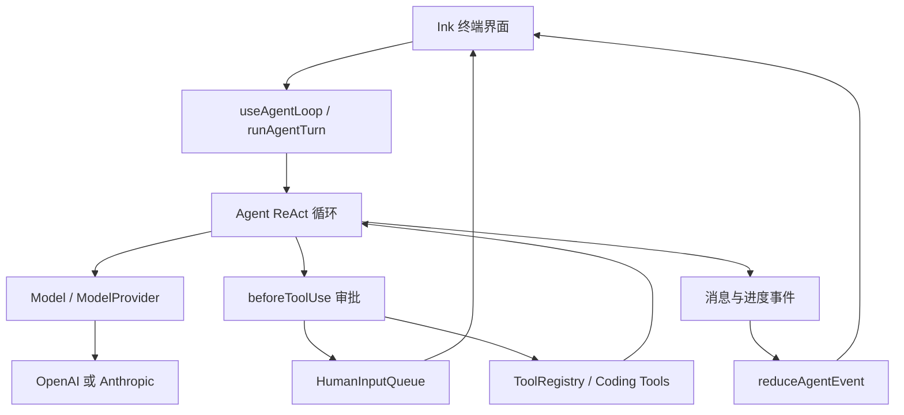

# harness-coding-lab

一个用 **TypeScript + Bun** 从基础模块逐步构建的 Coding Agent 学习项目。代码覆盖消息协议、模型适配、ReAct 循环、并行工具执行、中间件、项目规范与 Skills、待办管理，以及基于 React / Ink 的交互式终端。

既可以运行各阶段的离线示例理解实现，也可以配置真实模型，在终端中进行多轮对话、读取项目文件，并审批文件修改和命令执行。

## 当前能力

- 统一的消息、工具调用、工具结果和 Token 用量表示。
- OpenAI **Chat Completions** 与 Anthropic **Messages API** 适配，支持流式响应和函数工具调用。
- ReAct 执行循环：调用模型、执行工具、回传结果，直到得到最终回复或达到步数上限。
- 同一步中的多个工具并发执行，工具结果按完成顺序进入历史；取消信号贯穿模型、中间件和工具。
- 文件查看、搜索、修改、补丁和 Bash 执行工具，以及 `todo_write`、`ask_user_question`。
- 加载工作目录中的 `AGENTS.md` 和 Skills 元数据，按需读取 Skill 正文。
- 终端会话、模型配置命令、人工输入队列、一次性审批和项目级授权存储。

这是持续完善中的教学项目。完整质量门禁和部分边界测试仍有待补齐，见[验证与当前限制](#验证与当前限制)。

## 快速开始

### 1. 准备环境

- [Bun](https://bun.com/docs/installation) 1.4 系列；当前验证版本为 1.4.2。
- 交互式终端；Bash 工具及其进程组取消逻辑面向 macOS / Linux。
- 真实模型的 API Key 和网络访问权限。离线示例及单元测试不需要 API Key。
- 执行 ESLint 时还需要 Node.js；当前 ESLint / TypeScript 组合存在已知兼容问题。

```bash
git clone https://github.com/ljyzzZ/harness-coding-lab.git
cd harness-coding-lab
bun install --frozen-lockfile
```

### 2. 配置 API Key

首次使用时复制环境变量模板；已有 `.env` 时直接编辑它：

```bash
cp .env.example .env
```

在 `.env` 中填写：

```dotenv
OPENAI_API_KEY=your-api-key
```

Bun 启动时会加载 `.env`。该文件已被 Git 忽略；可提交的 YAML 配置只保存环境变量名称，不保存实际密钥。

### 3. 检查模型配置并启动

仓库提供的 [harness.config.yaml](harness.config.yaml) 默认配置为：

```yaml
defaultModel: openai
models:
  openai:
    provider: openai
    model: gpt-6-sol
    baseURL: https://api.openai.com/v1
    apiKeyEnv: OPENAI_API_KEY
    options:
      reasoning_effort: none
```

```bash
bun run dev
```

出现 `Ready` 和模型名称后即可输入问题。可以先输入 `只回复 OK，不要调用工具`，再输入 `hello world`，验证连续两轮对话。

**GPT-6 Sol 的接口要求：** 当前 OpenAI 适配器使用 `/v1/chat/completions`。按照 [OpenAI 官方模型文档](https://developers.openai.com/api/docs/models/gpt-6-sol)，`gpt-6-sol` 在此接口使用函数工具调用时需要 `reasoning_effort: none`。开启推理并使用工具需要 Responses API，本项目尚未实现该适配器。

想先离线体验客户端流程，可运行：

```bash
bun run examples/stage-10-text-client.ts
```

它使用 `ScriptedModelProvider`，预期输出 `assistant: client ready`，不会调用远程模型。

## 模型配置

配置格式和校验逻辑位于 [src/cli/config](src/cli/config)。

| 字段 | 含义 |
| --- | --- |
| `defaultModel` | `models` 中的配置名称，必须指向已有条目 |
| `provider` | `openai` 或 `anthropic` |
| `model` | 服务端模型 ID，需由当前账户和 endpoint 支持 |
| `baseURL` | 可选的 API 基础地址，可用于兼容相应协议的服务 |
| `apiKeyEnv` | 从哪个环境变量读取 API Key |
| `options` | 原样传给模型适配器的请求参数，例如 `reasoning_effort`、`max_tokens`；参数必须由对应 provider 支持 |

主 CLI 从 YAML 选择模型与请求参数。`.env.example` 中的 `OPENAI_MODEL`、`OPENAI_BASE_URL` 等变量主要供 `stage-07-real-model.ts` 使用；要修改默认 CLI 配置，应修改 YAML 中对应字段。

```bash
# 查看配置，* 表示默认模型
bun run dev config model list

# 添加另一个配置；YOUR_MODEL_ID 替换为账户可访问的模型 ID
bun run dev config model add backup \
  --provider openai \
  --model YOUR_MODEL_ID \
  --api-key-env OPENAI_API_KEY \
  --base-url https://api.openai.com/v1
```

`add` 命令只写入基础字段。若添加 `gpt-6-sol`，切换默认模型前还需要手动为新条目补上 `options.reasoning_effort: none`。Anthropic 配置使用 `--provider anthropic`，并指定它自己的模型 ID 和 API Key 环境变量。

```bash
bun run dev config model set-default backup

# 不能删除当前默认配置；先切换，再删除
bun run dev config model set-default openai
bun run dev config model remove backup

# 指定其他配置文件；该选项也适用于启动聊天
bun run dev --config ./harness.local.yaml config model list
```

所有模型选择在启动时读取，修改配置后需要重新启动会话。

## 终端操作

| 操作 | 行为 |
| --- | --- |
| 输入文字并按 Enter | 提交一轮对话；运行中不会启动第二轮并发对话 |
| `/help` | 显示可用命令 |
| `/clear` | 空闲时清空 Agent 历史、界面消息、Todo 和 Token 统计；不删除持久化授权 |
| `/exit` | 空闲时退出 |
| Ctrl+C | 正在运行时请求取消；空闲时退出 |
| 审批界面按 `a` | 仅允许本次工具调用 |
| 审批界面按 `p` | 允许本次调用，并保存当前项目对该工具的授权 |
| 审批界面按 `d` | 拒绝本次调用，向 Agent 返回拒绝结果 |
| 普通提问界面输入并按 Enter | 回答 `ask_user_question`；选项以文字提示展示 |

界面显示 `Ready` / `Working…`、完整消息、任务列表，以及最新一次模型请求的输入 Token 和会话累计 Token。统计依赖 provider 返回的 usage，不是费用估算。

### 工作目录与授权范围

启动时的 `process.cwd()` 是工具的工作目录。要操作其他项目，可从目标目录使用 CLI 和配置文件的绝对路径启动；API Key 需在该启动环境中可用：

```bash
cd /path/to/your-project
bun run /path/to/harness-coding-lab/src/cli/index.ts \
  --config /path/to/harness-coding-lab/harness.config.yaml
```

项目级授权保存到 `~/.config/harness-lab/approvals.json`，按**工作目录的真实路径 + 工具名称**区分。授权 `bash` 后，该项目后续 Bash 调用可以免于再次询问，并不只限于此前的某条命令。若要撤销授权，可在程序退出后移除该项目对应的工具记录。

需要审批的工具为 `bash`、`write_file`、`str_replace`、`apply_patch`、`mkdir`、`move_path`。CLI 的审批队列上限为 8；统一人工输入队列上限为 16。

文件工具会校验工作区路径，阻止路径穿越和指向工作区之外的符号链接。**Bash 直接在宿主机执行，不是操作系统沙箱**；其 `cwd` 只设置初始目录，不能限制命令访问范围。默认超时为 10 秒，stdout / stderr 分别保留至多 12,000 个字符。

## 项目结构与执行流程

```text
src/
├── foundation/       消息、模型与工具接口、脚本模型、工具注册表
├── community/        OpenAI / Anthropic 协议转换与流式响应累积
├── agent/            ReAct 循环、中间件、Skills、Todo
├── coding/
│   ├── agents/       组装 Coding Agent，读取项目规范
│   ├── tools/        文件、搜索、修改、Bash、用户提问工具
│   └── permissions/ 审批队列与授权持久化
└── cli/
    ├── config/      配置校验、模型工厂和配置命令
    └── tui/         Ink 界面、人工输入队列、状态 reducer、运行 Hook
examples/            分阶段可运行示例
fixture/             离线示例使用的演示工作区
docs/                手动验收说明
```



模型产生工具调用后，Agent 执行工具、记录结果，并再次请求模型；没有工具调用时结束本轮。默认最多运行 20 个 step。同一步的工具可以并发运行，但需要用户确认的审批会串行处理。

几个阅读和扩展入口：

| 入口 | 关注内容 |
| --- | --- |
| [Agent](src/agent/agent.ts) | 执行循环、事件、取消与消息历史 |
| [ModelProvider](src/foundation/models/model-provider.ts) | 新模型 provider 需要实现的 `invoke` / `stream` 接口 |
| [defineTool](src/foundation/tools/function-tool.ts) | 使用 Zod 定义工具输入与执行函数 |
| [AgentMiddleware](src/agent/agent-middleware.ts) | 模型、step、工具执行前后的扩展点 |
| [defineCodingAgent](src/coding/agents/coding-agent.ts) | 组装模型、编码工具、Skills、Todo 和权限中间件 |
| [useAgentLoop](src/cli/tui/hooks/use-agent-loop.ts) | 将 Agent 事件转换成 React 状态，处理提交、取消和清空 |
| [HumanInputQueue](src/cli/tui/human-input.ts) | 连接等待答案的 Promise 与 UI 提交，拒绝迟到答案 |

### 工具清单

| 用途 | 工具 |
| --- | --- |
| 查看与搜索 | `file_info`、`list_files`、`glob_search`、`grep_search`、`read_file` |
| 文件修改 | `mkdir`、`write_file`、`str_replace`、`apply_patch`、`move_path` |
| 命令执行 | `bash` |
| 任务与交互 | `todo_write`、`ask_user_question` |

工具输入包含 `description`，用于说明动作目的。`apply_patch` 支持创建文件与更新内容，当前不支持删除文件。

### 项目规范与 Skills

`defineCodingAgent` 读取工作目录根部的 `AGENTS.md`，默认最多 12,000 个字符，并将它加入模型提示词。Skills 默认从 `.agents/skills/<name>/SKILL.md` 发现，文件需有包含 `name`、`description` 的 YAML frontmatter。

启动时只提供 Skills 元数据，模型选中某项后再使用 `read_file` 读取正文。当前没有实现父目录或嵌套目录 `AGENTS.md` 的规则合并。

## 分阶段示例

除 Stage 07 外，下列示例使用脚本模型或本地工具，不调用远程模型。Stage 08 在临时目录执行文件操作并清理。

| 阶段 | 运行命令 | 内容 |
| --- | --- | --- |
| 01 | `bun run examples/stage-01-transcript.ts` | 统一消息与 transcript 格式化 |
| 02 | `bun run examples/stage-02-model-stream.ts` | 模型流式快照 |
| 03 | 见下方命令 | 工具参数校验与结果 |
| 04 | `bun run examples/stage-04-react-loop.ts` | ReAct 执行循环；这里的 ReAct 指推理与行动循环 |
| 05 | `bun run examples/stage-05-parallel-tools.ts` | 工具并发与完成顺序 |
| 05 | `bun run examples/stage-05-abort.ts` | 运行取消 |
| 06 | `bun run examples/stage-06-middleware.ts` | 生命周期中间件 |
| 07 | `bun run examples/stage-07-real-model.ts openai` | 真实 OpenAI 请求；也接受 `anthropic` 参数 |
| 08 | `bun run examples/stage-08-coding-tools.ts inspect` | 编码工具；还可选择 `edit`、`reject-path` |
| 09 | `bun run examples/stage-09-coding-agent.ts fixture` | 项目规范、Skills、Todo 和用户提问的集成 |
| 10 | `bun run examples/stage-10-text-client.ts` | 文本客户端与 Agent 事件连接 |

```bash
bun run examples/stage-03-tool-playground.ts add \
  '{"description":"计算两数之和","left":1,"right":2}'
```

## 验证与当前限制

```bash
bun run check:types  # TypeScript 类型检查
bun test            # 单元与集成测试
bun run lint        # ESLint
bun run check       # 类型检查、ESLint、测试，遇到失败就停止
```

截至本次交付，类型检查和 **216 个测试**通过；真实 `gpt-6-sol` 文本流、函数工具调用，以及包含空格输入的连续两轮对话已经验证。

**完整质量门禁尚未通过：** 当前 `typescript-eslint@8.72.1` 会拒绝加载 TypeScript 7.0，导致 `bun run lint` 和 `bun run check` 失败。由于 `check` 使用 `&&` 串联，ESLint 失败后不会继续运行测试，需要单独运行 `bun test`。这项工具链兼容问题仍待处理。

其他已知限制：

- TUI 当前展示完整消息，`progress` 事件不会逐字追加到界面历史。
- 会话历史和 Todo 仅保存在内存中，退出后不恢复；持久化的是项目级授权。
- `human-input`、界面 state、Token 统计、配置 schema 和审批相关的部分测试文件仍为空，现有测试通过不代表这些模块已充分覆盖。
- [审批中间件](src/coding/permissions/approval-middleware.ts)保存项目授权时，`signal` 的括号位置仍有错误，未实际传入 `waitWithSignal`；正常保存可用，但取消不能及时中断这一段等待。
- 尚未提供 Responses API、跨平台 Bash 隔离或会话恢复能力。

交互操作的验收步骤见 [docs/manual-test.md](docs/manual-test.md)。

### 常见问题

| 现象 | 排查方向 |
| --- | --- |
| `Missing environment variable` | 检查当前选中配置的 `apiKeyEnv`，以及启动进程是否读取到了对应环境变量 |
| `Connection error` | 检查 API 地址、DNS、代理和网络限制；与模型返回的 HTTP 400 区分 |
| `401` / 模型无访问权限 | 检查 API Key、账户模型权限和 provider 地址是否对应 |
| `messages[n].tool_calls: empty array` | 旧转换逻辑会给纯文本历史添加空数组；本次已修复，更新代码并重启进程。空格不是触发原因 |
| 默认模型不能删除 | 先用 `config model set-default` 切换到其他已存在配置 |
| `Input tokens` 为 0 | 当前还没有收到包含 usage 的完整模型消息，或服务没有报告 usage |

## 开发约定

使用 `bun add <package>` 更新依赖，并把 `package.json` 与 `bun.lock` 一起提交。仓库的 [bunfig.toml](bunfig.toml) 固定使用公共 npm registry；个人 registry 凭据留在用户级配置中。

新增功能时，应优先用 `ScriptedModelProvider` 或可注入的 SDK client 验证协议转换、事件顺序、取消和错误路径，再按需进行真实 API 验证。代码中的部分 `TODO` 保留了学习说明，是否完成应以实际实现与测试为准。
